# Empirical Bayes Deconvolution

## A simulation example

We start with a simulated Poisson example where the \\\Theta_i\\ are
drawn from a chi-squared density with 10 degrees of freedom and the
\\X_i\|\Theta_i\\ are Poisson with expectation \\\Theta_i:\\

\\ \Theta_i \sim \chi^2\_{10} \mbox{ and } X_i\|\Theta_i \sim
\mbox{Poisson}(\Theta_i) \\

The \\\Theta_i\\ for this setting, with `N = 1000` observations can be
generated as follows.

``` r

set.seed(238923) ## for reproducibility
N <- 1000
Theta <- rchisq(N,  df = 10)
```

Next, the \\X_i\|\Theta_i\\, for each of `nSIM = 1000` simulations can
be generated as below.

``` r

nSIM <- 1000
data <- sapply(seq_len(nSIM), function(x) rpois(n = N, lambda = Theta))
```

We take the discrete set \\\mathcal{T}=(1, 2, \ldots, 32)\\ as the
\\\Theta\\-space and apply the `deconv` function in the package
`deconvolveR` to estimate \\g(\theta).\\

``` r

library(deconvolveR)
tau <- seq(1, 32)
results <- apply(data, 2,
                 function(x) deconv(tau = tau, X = x, ignoreZero = FALSE,
                                    c0 = 1))
```

The default setting for `deconv` uses the `Poisson` family and a natural
cubic spline basis of degree 5 as \\Q.\\ The regularization parameter
for this example (`c0`) is set to 1. The `ignoreZero` parameter
indicates that this dataset contains zero counts, i.e., there zeros have
not been truncated. (In the Shakespeare example below, the counts are of
words seen in the canon, and so there is a natural truncation at zero.)

Some warnings are emitted by the `nlm` routine used for optimization,
but they are mostly inconsequential.

Since `deconv` works on a sample at a time, the result above is a list
of lists from which various statistics can be extracted. Below, we
construct a table of values for various values of \\\Theta\\.

``` r

g <- sapply(results, function(x) x$stats[, "g"])
mean <- apply(g, 1, mean)
SE.g <- sapply(results, function(x) x$stats[, "SE.g"])
sd <- apply(SE.g, 1, mean)
Bias.g <- sapply(results, function(x) x$stats[, "Bias.g"])
bias <- apply(Bias.g, 1, mean)
gTheta <- pchisq(tau, df = 10) - pchisq(c(0, tau[-length(tau)]), df = 10)
gTheta <- gTheta / sum(gTheta)
simData <- data.frame(theta = tau, gTheta = gTheta,
                      Mean = mean, StdDev = sd, Bias = bias,
                      CoefVar = sd / mean)
table1 <- transform(simData,
                    gTheta = 100 * gTheta,
                    Mean = 100 * Mean,
                    StdDev = 100 * StdDev,
                    Bias = 100 * Bias)
```

The table below summarizes the results for some chosen values of
\\\theta .\\

``` r

knitr::kable(table1[c(5, 10, 15, 20, 25), ], row.names=FALSE)
```

| theta |    gTheta |      Mean |    StdDev |       Bias |   CoefVar |
|------:|----------:|----------:|----------:|-----------:|----------:|
|     5 | 5.6191465 | 5.4416722 | 0.3635378 | -0.1235865 | 0.0668063 |
|    10 | 9.1646990 | 9.5316279 | 0.4917673 |  0.2588187 | 0.0515932 |
|    15 | 4.0946148 | 3.3421426 | 0.3119862 | -0.0683187 | 0.0933492 |
|    20 | 1.1014405 | 0.9810001 | 0.2246999 | -0.1225092 | 0.2290519 |
|    25 | 0.2255788 | 0.1496337 | 0.0677919 |  0.0602422 | 0.4530522 |

Although, the coefficient of variation of \\\hat{g}(\theta)\\ is still
large, the \\g(\theta)\\ estimates are reasonable.

We can compare the empirical standard deviations and biases of
\\g(\hat{\alpha})\\ with the approximation given by the formulas in the
paper.

``` r

library(ggplot2)
library(cowplot)
theme_set(theme_get() +
          theme(panel.grid.major = element_line(colour = "gray90",
                                                size = 0.2),
                panel.grid.minor = element_line(colour = "gray98",
                                                size = 0.5)))
p1 <- ggplot(data = as.data.frame(results[[1]]$stats)) +
    geom_line(mapping = aes(x = theta, y = SE.g), color = "black", linetype = "solid") +
    geom_line(mapping = aes(x = simData$theta, y = simData$StdDev), color = "red", linetype = "dashed") +
    labs(x = expression(theta), y = "Std. Dev")

p2 <- ggplot(data = as.data.frame(results[[1]]$stats)) +
    geom_line(mapping = aes(x = theta, y = Bias.g), color = "black", linetype = "solid") +
    geom_line(mapping = aes(x = simData$theta, y = simData$Bias), color = "red", linetype = "dashed") +
    labs(x = expression(theta), y = "Bias")
plot_grid(plotlist = list(p1, p2), ncol = 2)
```

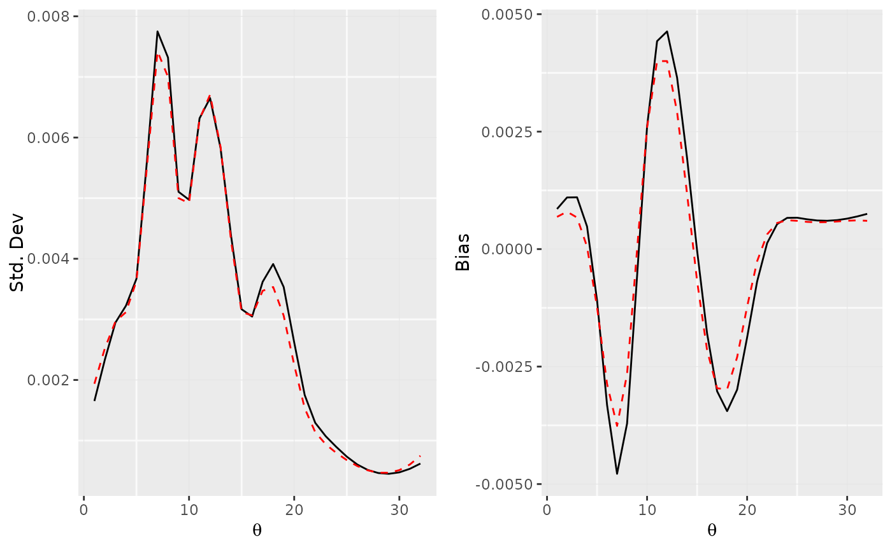

The approximation is quite good for the standard deviations, but a
little too small for the biases.

## The Shakespeare data

Here we are given the word counts for the entire Shakespeare canon in
the data set `bardWordCount`. We assume the \\i\\th distinct word
appeared \\X_i \sim Poisson(\Theta_i)\\ times in the canon.

``` r

data(bardWordCount)
str(bardWordCount)
```

    ##  num [1:100] 14376 4343 2292 1463 1043 ...

We take the support set \\\mathcal{T}\\ for \\\Theta\\ to be equally
spaced on the log-scale and the sample space for \\\mathcal{X}\\ to be
\\(1,2,\ldots,100).\\

``` r

lambda <- seq(-4, 4.5, .025)
tau <- exp(lambda)
```

Using a regularization parameter of `c0=2` we can deconvolve the data to
get \\\hat{g}.\\

``` r

result <- deconv(tau = tau, y = bardWordCount, n = 100, c0=2)
stats <- result$stats
```

The plot below shows the Empirical Bayes deconvoluation estimates for
the Shakespeare word counts.

``` r

ggplot() +
    geom_line(mapping = aes(x = lambda, y = stats[, "g"])) +
    labs(x = expression(log(theta)), y = expression(g(theta)))
```

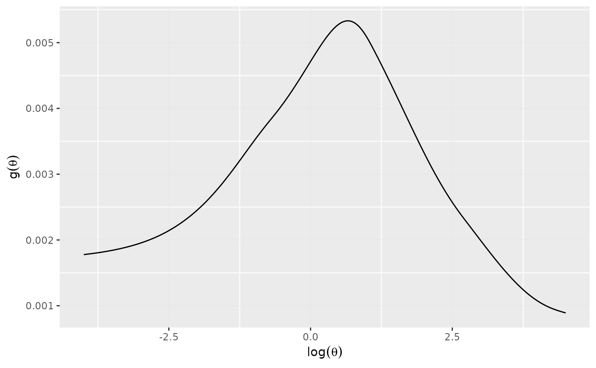

The quantity \\R(\alpha)\\ in the paper (Efron, Biometrika 2015) can be
extracted from the `stats` list; in this case for a regularization
parameter of `c0=2` we can print its value:

``` r

print(result$S)
```

    ## [1] 0.005534954

The `stats` list contains other estimates quantities as well.

As noted in the paper citing this package, about 44 percent of the total
mass of \\\hat{g}\\ lies below \\\Theta = 1\\, which is an
underestimate. This can be corrected for by defining \\ \tilde{g} =
c_1\hat{g} / (1 - e^{-\theta_j}), \\ where \\c_1\\ is the constant that
normalizes \\\tilde{g}\\.

When there is truncation at zero, as is the case here, the `deconvolveR`
package now returns an additional column in `stats[, "tg"]` which
contains this correction for *thinning*. (The default invocation of
`deconv` assumes zero truncation for the Poisson family, argument
`ignoreZero = FALSE`).

``` r

d <- data.frame(lambda = lambda, g = stats[, "g"], tg = stats[, "tg"], SE.g = stats[, "SE.g"])
indices <- seq(1, length(lambda), 5)
ggplot(data = d) +
    geom_line(mapping = aes(x = lambda, y = g)) +
    geom_errorbar(data = d[indices, ],
                  mapping = aes(x = lambda, ymin = g - SE.g, ymax = g + SE.g),
                  width = .01, color = "blue") +
    labs(x = expression(log(theta)), y = expression(g(theta))) +
    ylim(0, 0.006) +
    geom_line(mapping = aes(x = lambda, y = tg), linetype = "dashed", color = "red")
```

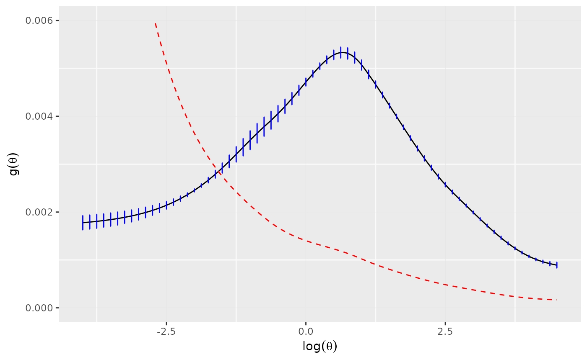

We can now plot the posterior estimates.

``` r

gPost <- sapply(seq_len(100), function(i) local({tg <- d$tg * result$P[i, ]; tg / sum(tg)}))
plots <- lapply(c(1, 2, 4, 8), function(i) {
    ggplot() +
        geom_line(mapping = aes(x = tau, y = gPost[, i])) +
        labs(x = expression(theta), y = expression(g(theta)),
             title = sprintf("x = %d", i))
})
plots <- Map(f = function(p, xlim) p + xlim(0, xlim), plots, list(6, 8, 14, 20))
plot_grid(plotlist = plots, ncol = 2)
```

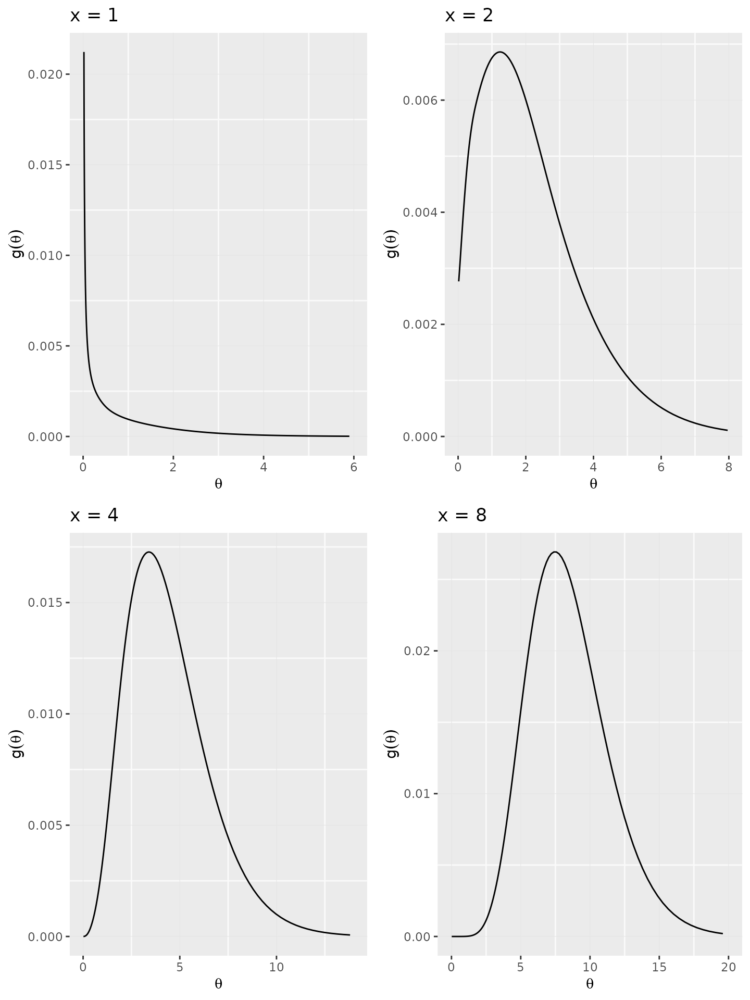

### Bootstrap Comparison

As a check, one can perform a parametric bootstrap using \\ y^{\*} \sim
Mult_n(N, {\mathbf f}) \\ with the MLE \\\hat{\mathbf f} = {\mathbf
f}(\hat{\alpha})\\. We use 200 bootstrap replcates to compute the
standard errors for \\\hat{g}\\ and compare them to the theoretical
values in the plot below. The agreement is pretty good.

``` r

set.seed(1783)
B <- 200
fHat <- as.numeric(result$P %*% d$g)
fHat <- fHat / sum(fHat)
yStar <- rmultinom(n = B, size = sum(bardWordCount), prob = fHat)
gBoot <- apply(yStar, 2,
               function(y) deconv(tau = tau, y = y, n = 100, c0 = 2)$stats[, "g"])
seG <- apply(gBoot, 1, sd)
ggplot(data = d) +
    geom_line(mapping = aes(x = lambda, y = SE.g,
                            color = "Theoretical", linetype = "Theoretical")) +
    geom_line(mapping = aes(x = lambda, y = seG,
                            color = "Bootstrap", linetype = "Bootstrap")) +
    scale_color_manual(name = "Legend",
                       values = c("Bootstrap" = "black", "Theoretical" = "red")) +
    scale_linetype_manual(name = "Legend",
                          values = c("Bootstrap" = "solid", "Theoretical" = "dashed")) +
    theme(legend.title = element_blank()) +
    labs(x = expression(log(theta)), y = expression(sigma(hat(g))))
```

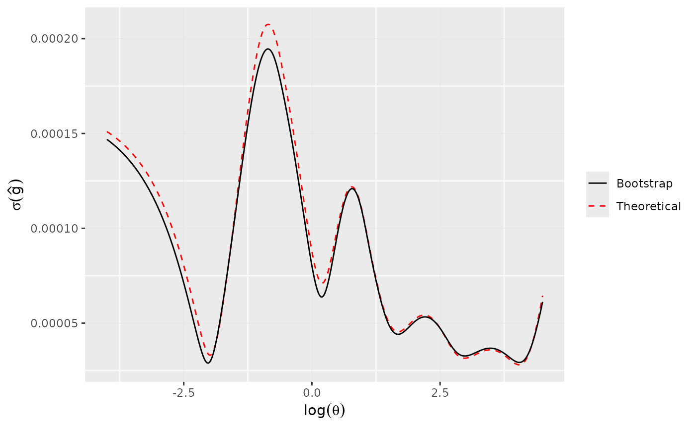

### Predict ratio of new distinct words

Suppose then that a previously unknown Shakespearean corpus of length
\\t\times C\\ were found, \\C\times 900,000\\ the length of the known
canon. Assuming a Poisson process model with intensity \\\Theta_i\\ for
word \\i\\, the probability that word \\i\\ did not appear in the canon
but does appear in the new corpus is \\
e^{-\Theta_i}\left(1-e^{-\Theta_it}\right); \\ yielding after some work,
an estimate for \\R(t)\\, the expected number of distinct new words
found, divided by \\N\\, the observed number of distinct words in the
canon: \\ R(t)=\sum\_{j=1}^m\hat{g}\_jr_j(t), \\ with \\
r_j=\frac{e^{-\theta\_{(j)}}}{1-e^{-\theta\_{(j)}}}\left(1-e^{-\theta\_{(j)}t}\right).
\\

We can compute the \\R(t)\\ and plot it as follows.

``` r

gHat <- stats[, "g"]
Rfn <- function(t) {
    sum( gHat * (1 - exp(-tau * t)) / (exp(tau) - 1) )
}
r <- sapply(0:10, Rfn)
ggplot() +
    geom_line(mapping = aes(x = 0:10, y = r)) +
    labs(x = "time multiple t", y = expression(R(t)))
```

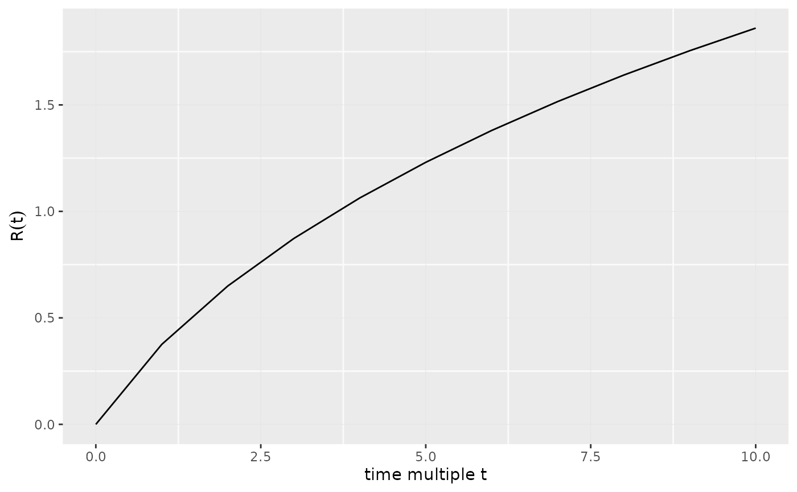

And the (speculative) doubling time for Shakespeare’s vocabulary is easy
to compute too.

``` r

print(uniroot(f = function(x) Rfn(x) - 1, interval = c(2, 4))$root)
```

    ## [1] 3.653132

## Normal Example

Consider a data set that is generated via the following mechanism.

\\ z_i \sim N(\mu_i, 1), \mbox{ \$i = 1,2,\ldots, N = 10,000\$} \\

with

\\ \mu_i= \begin{cases} 0, & \mbox{with probability .9}\\ N(-3, 1), &
\mbox{with probability .1}\\ \end{cases} \\

``` r

set.seed(129023)
N <- 10000
pi0 <- .90
data <- local({
    nullCase <- (runif(N) <= pi0)
    muAndZ <- t(sapply(nullCase, function(isNull) {
        if (isNull) {
            mu <- 0
            c(mu, rnorm(1))
        } else {
            mu <- rnorm(1, mean = -3)
            c(mu, rnorm(1, mean = mu))
        }
    }))
    data.frame(nullCase = nullCase, mu = muAndZ[, 1], z = muAndZ[, 2])
})
```

Below is a histogram of the data (\\z\\ values) and that of the
\\\Theta\\s.

``` r

p1 <- ggplot(mapping = aes(x = data$z)) +
    geom_histogram(mapping = aes(y  = ..count.. / sum(..count..) ),
                   color = "brown", bins = 60, alpha = 0.5) +
    labs(x = "z", y = "Density")
p2 <- ggplot(mapping = aes(x = data$mu)) +
    geom_histogram(mapping = aes(y  = ..count.. / sum(..count..) ),
                   color = "brown", bins = 60, alpha = 0.5) +
    labs(x = expression(theta), y = "Density")
plot_grid(plotlist = list(p1, p2), ncol = 2)
```

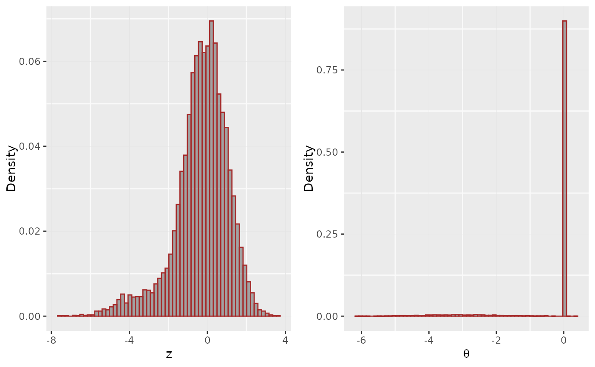

Now we deconvolve this using \\\mathcal{T} = (-6, -5.75,\ldots, 3)\\ and
a spike at zero and a fifth-degree polynomial.

``` r

tau <- seq(from = -6, to = 3, by = 0.25)
atomIndex <- which(tau == 0)
result <- deconv(tau = tau, X = data$z, deltaAt = 0, family = "Normal", pDegree = 5)
```

The estimates and the standard errors of the penalized MLE \\\hat{g}\\
with `c0 = 1` are shown below.

``` r

knitr::kable(result$stats)
```

| theta |         g |      SE.g |         G |      SE.G |     Bias.g |
|------:|----------:|----------:|----------:|----------:|-----------:|
| -6.00 | 0.0001755 | 0.0001139 | 0.0001755 | 0.0001139 |  0.0002100 |
| -5.75 | 0.0003137 | 0.0001627 | 0.0004892 | 0.0002764 |  0.0002944 |
| -5.50 | 0.0005542 | 0.0002188 | 0.0010434 | 0.0004943 |  0.0003817 |
| -5.25 | 0.0009558 | 0.0002710 | 0.0019991 | 0.0007611 |  0.0004355 |
| -5.00 | 0.0015902 | 0.0003068 | 0.0035893 | 0.0010496 |  0.0003936 |
| -4.75 | 0.0025218 | 0.0003396 | 0.0061111 | 0.0013181 |  0.0001835 |
| -4.50 | 0.0037665 | 0.0004384 | 0.0098775 | 0.0015480 | -0.0002271 |
| -4.25 | 0.0052352 | 0.0006237 | 0.0151127 | 0.0017954 | -0.0007502 |
| -4.00 | 0.0067030 | 0.0007782 | 0.0218157 | 0.0021384 | -0.0011392 |
| -3.75 | 0.0079323 | 0.0008168 | 0.0297481 | 0.0025338 | -0.0011786 |
| -3.50 | 0.0087575 | 0.0007875 | 0.0385055 | 0.0028572 | -0.0008249 |
| -3.25 | 0.0091050 | 0.0008190 | 0.0476105 | 0.0030494 | -0.0001984 |
| -3.00 | 0.0089988 | 0.0009356 | 0.0566093 | 0.0031703 |  0.0004827 |
| -2.75 | 0.0085341 | 0.0010240 | 0.0651434 | 0.0033244 |  0.0009991 |
| -2.50 | 0.0078394 | 0.0010049 | 0.0729829 | 0.0035304 |  0.0012035 |
| -2.25 | 0.0070391 | 0.0009187 | 0.0800220 | 0.0036975 |  0.0010485 |
| -2.00 | 0.0062096 | 0.0009410 | 0.0862315 | 0.0037737 |  0.0006476 |
| -1.75 | 0.0053923 | 0.0011197 | 0.0916239 | 0.0038631 |  0.0001722 |
| -1.50 | 0.0046182 | 0.0013216 | 0.0962421 | 0.0041634 | -0.0002559 |
| -1.25 | 0.0039083 | 0.0014443 | 0.1001503 | 0.0047866 | -0.0005669 |
| -1.00 | 0.0032743 | 0.0014544 | 0.1034247 | 0.0056648 | -0.0007344 |
| -0.75 | 0.0027209 | 0.0013594 | 0.1061456 | 0.0066420 | -0.0007631 |
| -0.50 | 0.0022468 | 0.0011884 | 0.1083923 | 0.0075782 | -0.0006763 |
| -0.25 | 0.0018442 | 0.0009889 | 0.1102365 | 0.0083898 | -0.0005154 |
|  0.00 | 0.8846685 | 0.0103603 | 0.9949050 | 0.0032481 | -0.0007798 |
|  0.25 | 0.0012121 | 0.0006634 | 0.9961171 | 0.0026657 | -0.0001414 |
|  0.50 | 0.0009670 | 0.0005580 | 0.9970841 | 0.0021484 |  0.0000199 |
|  0.75 | 0.0007616 | 0.0004773 | 0.9978457 | 0.0016891 |  0.0001464 |
|  1.00 | 0.0005909 | 0.0004069 | 0.9984366 | 0.0012899 |  0.0002343 |
|  1.25 | 0.0004510 | 0.0003385 | 0.9988876 | 0.0009551 |  0.0002847 |
|  1.50 | 0.0003383 | 0.0002718 | 0.9992259 | 0.0006855 |  0.0003024 |
|  1.75 | 0.0002500 | 0.0002114 | 0.9994759 | 0.0004756 |  0.0002951 |
|  2.00 | 0.0001824 | 0.0001602 | 0.9996583 | 0.0003163 |  0.0002713 |
|  2.25 | 0.0001318 | 0.0001191 | 0.9997901 | 0.0001977 |  0.0002386 |
|  2.50 | 0.0000945 | 0.0000875 | 0.9998846 | 0.0001104 |  0.0002027 |
|  2.75 | 0.0000674 | 0.0000639 | 0.9999520 | 0.0000466 |  0.0001677 |
|  3.00 | 0.0000480 | 0.0000466 | 1.0000000 | 0.0000000 |  0.0001360 |

Per the above table, the estimated probability of \\\mu = 0\\ is 0.885
\\\pm\\ 0.01 with a bias of about -0.001.

We can now plot the \\g\\-estimate removing the atom at 0.

``` r

gData <- as.data.frame(result$stats[-atomIndex, c("theta", "g")])
gData$g <- gData$g / sum(gData$g)
ggplot(data = gData) +
    geom_line(mapping = aes(x = theta, y = g)) +
    geom_line(mapping = aes(x = theta, y = dnorm(theta, mean = -3)),
                            color = "red") +
    labs(x = expression(theta), y = expression(g(theta)))
```

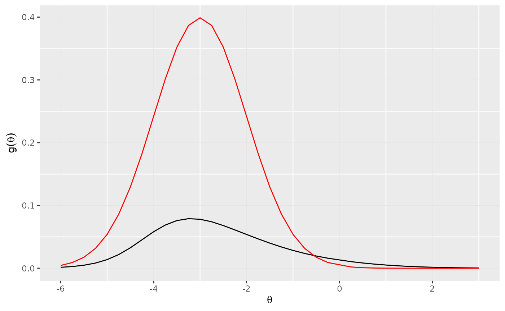

The density approximation is not accurate at all, however, the posterior
estimates for the g’s are similar to what one obtains by the
Benjamini-Yekutieli procedure as shown below.

1.  Sort the \\p\\-values.

``` r

p <- pnorm(data$z)
orderP <- order(p)
p <- p[orderP]
```

2.  Compute \\R\\, the number of discoveries and count the number of
    false discoveries

``` r

## FCR
q <- 0.05
R <- max(which(p <= seq_len(N) * q / N))
discIdx <- orderP[1:R]
disc <- data[discIdx, ]
cat("BY_q procedure discoveries", R, "cases,", sum(disc$nullCase),
    "actual nulls among them.\n")
```

    ## BY_q procedure discoveries 610 cases, 22 actual nulls among them.

3.  Construct Benjamini-Yekutieli and Bayes confidence intervals.

``` r

alphaR <- 1 - R * q / N
zAlpha <- qnorm(alphaR, lower.tail = FALSE)
zMarker <- max(disc$z)
xlim <- c(-7.6, 0.0)
ylim <- c(-10, 0.0)
BY.lo <- c(xlim[1] - zAlpha, xlim[2] - zAlpha)
BY.up <- c(xlim[1] + zAlpha, xlim[2] + zAlpha)
Bayes.lo <- c(0.5 * (xlim[1] - 3) - 1.96 / sqrt(2), 0.5 * (xlim[2] - 3) - 1.96 / sqrt(2))
Bayes.up <- c(0.5 * (xlim[1] - 3) + 1.96 / sqrt(2), 0.5 * (xlim[2] - 3) + 1.96 / sqrt(2))
```

4.  Compute the estimated posterior density for of \\\mu\\ given \\z\\
    and construct the 95% credible intervals for \\\mu\\ given \\z\\.

``` r

d <- data[order(data$mu), ]
muVals <- unique(d$mu)
s <- as.data.frame(result$stats)
indices <- findInterval(muVals, s$theta) + 1
gMu <- s$g[indices]
st <- seq(min(data$z), -2.0, length.out = 40)
gMuPhi <- sapply(st, function(z) gMu * dnorm(z - muVals))
g2 <- apply(gMuPhi, 2, function(x) cumsum(x)/sum(x))
pct <- apply(g2, 2, function(dist) approx(y = muVals, x = dist, xout = c(0.025, 0.975)))
qVals <- sapply(pct, function(item) item$y)
```

5.  Plot it

``` r

ggplot() +
    geom_line(mapping = aes(x = xlim, y = BY.lo), color = "blue") +
    geom_line(mapping = aes(x = xlim, y = BY.up), color = "blue") +
    geom_line(mapping = aes(x = xlim, y = Bayes.lo), color = "magenta",
              linetype = "dashed") +
    geom_line(mapping = aes(x = xlim, y = Bayes.up), color = "magenta",
              linetype = "dashed") +
    geom_point(mapping = aes(x = disc$z, y = disc$mu), color = "red") +
    geom_point(mapping = aes(x = disc$z[disc$nullCase], y = disc$mu[disc$nullCase]),
                             color = "orange") +
    geom_line(mapping = aes(x = rep(zMarker, 2), y = c(-10, 1))) +
    geom_line(mapping = aes(x = st, y = qVals[1, ]), color = "brown") +
    geom_line(mapping = aes(x = st, y = qVals[2, ]), color = "brown") +
    labs(x = "Observed z", y = expression(mu)) +
    annotate("text", x = -1, y = -4.25, label = "BY.lo") +
    annotate("text", x = -1, y = 1.25, label = "BY.up") +
    annotate("text", x = -7.5, y = -6.1, label = "Bayes.lo") +
    annotate("text", x = -7.5, y = -3.4, label = "Bayes.up") +
    annotate("text", x = -2.0, y = -1.75, label = "EB.lo") +
    annotate("text", x = -2.0, y = -3.9, label = "EB.up") +
    annotate("text", x = zMarker, y = 1.25, label = as.character(round(zMarker, 2)))
```

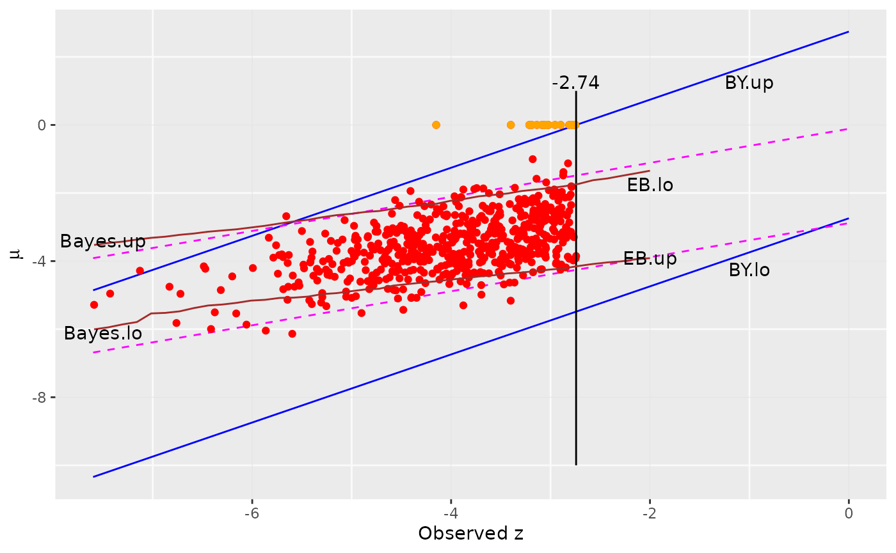

## Another Normal example (Twin Towers)

In the first normal example, the \\\theta\\ distribution had a
significant atom at 0 and the rest of the density was smeared around -3.
We now investigate what happens when the \\\theta\\ distribution is
clearly bimodal. Below is a histogram of the the \\\theta\\ and
alongside a histogram of the data, generated using \\X_i \sim
N(\theta_i, 1)\\.

``` r

p1 <- ggplot(mapping = aes(x = disjointTheta)) +
    geom_histogram(mapping = aes(y  = ..count.. / sum(..count..) ),
                   color = "brown", bins = 60, alpha = 0.5) +
    labs(x = expression(theta), y = "Density")
set.seed (2332)
z <- rnorm(n = length(disjointTheta), mean = disjointTheta)
p2 <- ggplot(mapping = aes(x = z)) +
    geom_histogram(mapping = aes(y  = ..count.. / sum(..count..) ),
                   color = "brown", bins = 60, alpha = 0.5) +
    labs(x = "z", y = "Density")
plot_grid(plotlist = list(p1, p2), ncol = 2)
```

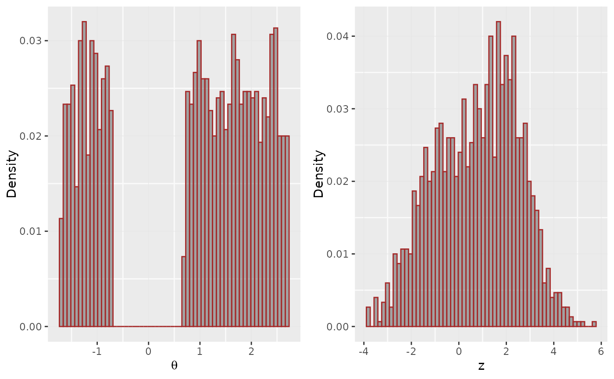

We deconvolve the data, using various values for the spline degrees of
freedom.

``` r

tau <- seq(from = -4, to = 6, by = 0.2)
plots1 <- lapply(2:8,
                 function(p) {
                     result <- deconv(tau = tau, X = z, family = "Normal", pDegree = p)
                     g <- result$stats[, "g"]
                     ggplot(mapping = aes(x = disjointTheta)) +
                         geom_histogram(mapping = aes(y = ..count.. / sum(..count..)),
                                        color = "brown", bins = 60, alpha = 0.2) +
                         geom_line(mapping = aes(x = tau, y = g), color = "blue") +
                         labs(x = expression(theta), y = "Density",
                              title = sprintf("DF = %d", p))
                })
```

Choosing the degrees of freedom to be 7, we now examine the effect of
regularization parameter \\c0\\.

``` r

plots2 <- lapply(c(0.5, 1, 2, 4, 8, 16, 32),
                 function(c0) {
                     result <- deconv(tau = tau, X = z, family = "Normal", pDegree = 6,
                                      c0 = c0)
                     g <- result$stats[, "g"]
                     ggplot(mapping = aes(x = disjointTheta)) +
                         geom_histogram(mapping = aes(y = ..count.. / sum(..count..)),
                                        color = "brown", bins = 60, alpha = 0.2) +
                         geom_line(mapping = aes(x = tau, y = g), color = "blue") +
                         labs(x = expression(theta), y = "Density",
                              title = sprintf("C0 = %.1f", c0))
                })
plots <- mapply(function(x, y) list(x, y), plots1, plots2)
plot_grid(plotlist = plots, ncol = 2)
```

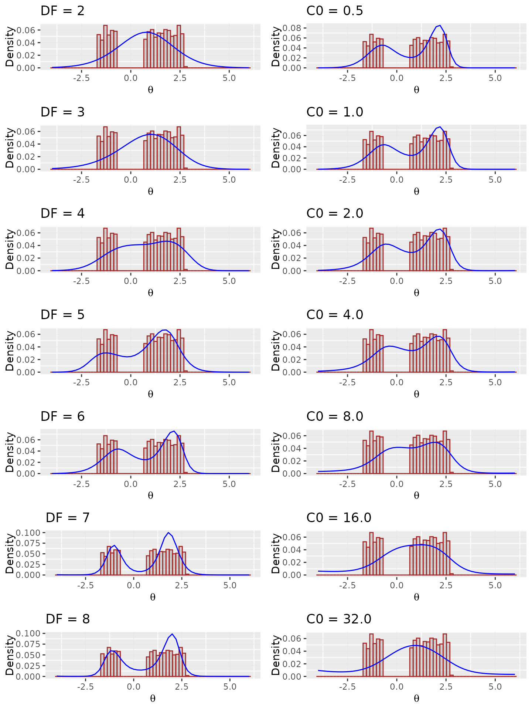

The quantity \\S(\alpha)\\ is a measure of the strength of the penalty
term \\c_0\\ and is returned by `deconv` in the result list as a named
item `S`. Below we vary \\c_0\\ and degrees of freedom from 5 to 7 to
gauge the effect of the regularization.

``` r

c0_values <- c(.5, 1, 2, 4, 8, 16, 32)
stable <- data.frame(
    c0 = c0_values,
    `DF 5` = sapply(c0_values, function(c0) deconv(tau = tau, X = z, family = "Normal", pDegree = 5, c0 = c0)$S),
    `DF 6` = sapply(c0_values, function(c0) deconv(tau = tau, X = z, family = "Normal", pDegree = 6, c0 = c0)$S),
    `DF 7` = sapply(c0_values, function(c0) deconv(tau = tau, X = z, family = "Normal", pDegree = 7, c0 = c0)$S)
)
knitr::kable(stable)
```

|   c0 |      DF.5 |      DF.6 |      DF.7 |
|-----:|----------:|----------:|----------:|
|  0.5 | 0.0010381 | 0.0013048 | 0.0018553 |
|  1.0 | 0.0029450 | 0.0034142 | 0.0042665 |
|  2.0 | 0.0082974 | 0.0090723 | 0.0102037 |
|  4.0 | 0.0236310 | 0.0248144 | 0.0257369 |
|  8.0 | 0.0685852 | 0.0708393 | 0.0697542 |
| 16.0 | 0.1915350 | 0.2039325 | 0.2025109 |
| 32.0 | 0.4831292 | 0.5385301 | 0.5698289 |

A DF of 6 or 7 captures the bimodality and a choice of \\c_0 \< 4\\
would avoid excessive penalization.

## Binomial Example

The dataset `surg` contains data on intestinal surgery on 844 cancer
patients. In the study, surgeons removed *satellite* nodes for later
testing. The data consists of pairs \\(n_i, X_i)\\ where \\n_i\\ is the
number of satellites removed and \\X_i\\ is the number found to be
malignant among them.

We assume a binomial model with \\X_i \sim Binomial(n_i, \theta_i)\\
with \\\theta_i\\ being the probability of any one satellite site being
malignant for the \\i\\th patient.

We take \\\mathcal{T} = (0.01, 0.02,\ldots, 0.09)\\, so \\m = 99.\\ We
take \\Q\\ to be the default 5-degree natural spline with columns
standardized to mean 0 and sum of squares equal to 1. The penalization
parameter is set to 1. The figure below shows the estimated prior
density of \\g(\theta)\\.

``` r

tau <- seq(from = 0.01, to = 0.99, by = 0.01)
result <- deconv(tau = tau, X = surg, family = "Binomial", c0 = 1)
d <- data.frame(result$stats)
indices <- seq(5, 99, 5)
errorX <- tau[indices]
ggplot() +
    geom_line(data = d, mapping = aes(x = tau, y = g)) +
    geom_errorbar(data = d[indices, ],
                  mapping = aes(x = theta, ymin = g - SE.g, ymax = g + SE.g),
                  width = .01, color = "blue") +
    labs(x = expression(theta), y = expression(paste(g(theta), " +/- SE")))
```

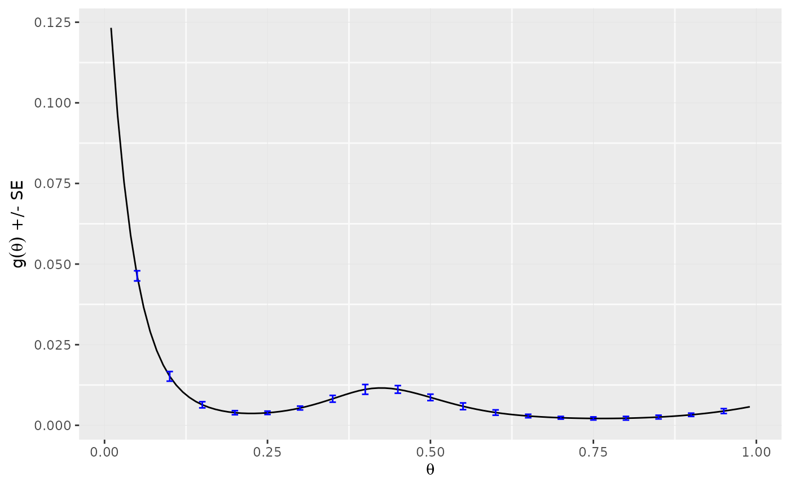

The complete table of estimates and standard errors is also available.

``` r

knitr::kable(d[indices, ], row.names = FALSE)
```

| theta |         g |      SE.g |         G |      SE.G |     Bias.g |
|------:|----------:|----------:|----------:|----------:|-----------:|
|  0.05 | 0.0463457 | 0.0015738 | 0.4000686 | 0.0187280 | -0.0001386 |
|  0.10 | 0.0151816 | 0.0014905 | 0.5227891 | 0.0179368 |  0.0005557 |
|  0.15 | 0.0063608 | 0.0009530 | 0.5679756 | 0.0177951 |  0.0004028 |
|  0.20 | 0.0039081 | 0.0006332 | 0.5910638 | 0.0182757 |  0.0002736 |
|  0.25 | 0.0038724 | 0.0005167 | 0.6098155 | 0.0187490 |  0.0002012 |
|  0.30 | 0.0053573 | 0.0005917 | 0.6330463 | 0.0188231 |  0.0000993 |
|  0.35 | 0.0082256 | 0.0010482 | 0.6679794 | 0.0180358 | -0.0001306 |
|  0.40 | 0.0111402 | 0.0015163 | 0.7184355 | 0.0170109 | -0.0004107 |
|  0.45 | 0.0111343 | 0.0011809 | 0.7755223 | 0.0167801 | -0.0003743 |
|  0.50 | 0.0086588 | 0.0009940 | 0.8242825 | 0.0155204 | -0.0000980 |
|  0.55 | 0.0058962 | 0.0010407 | 0.8590792 | 0.0135817 |  0.0001197 |
|  0.60 | 0.0039564 | 0.0008251 | 0.8823476 | 0.0125338 |  0.0002037 |
|  0.65 | 0.0028839 | 0.0005341 | 0.8986379 | 0.0120984 |  0.0002143 |
|  0.70 | 0.0023398 | 0.0004140 | 0.9112647 | 0.0114461 |  0.0002039 |
|  0.75 | 0.0021301 | 0.0004763 | 0.9222208 | 0.0103935 |  0.0001911 |
|  0.80 | 0.0021935 | 0.0005645 | 0.9329514 | 0.0092023 |  0.0001796 |
|  0.85 | 0.0025512 | 0.0005742 | 0.9448671 | 0.0082261 |  0.0001632 |
|  0.90 | 0.0032568 | 0.0005083 | 0.9595831 | 0.0072551 |  0.0001253 |
|  0.95 | 0.0044141 | 0.0007505 | 0.9791329 | 0.0048537 |  0.0000355 |

The empirical Bayes estimate of the prior distribution puts most of its
mass on the small values as can be seem below.

``` r

cat(sprintf("Mass below .20 = %0.2f\n", sum(d[1:20, "g"])))
```

    ## Mass below .20 = 0.59

``` r

cat(sprintf("Mass above .80 = %0.2f\n", sum(d[80:99, "g"])))
```

    ## Mass above .80 = 0.07

### Posterior Estimates

The posterior distribution of \\\theta_i\\ given \\(n_i, X_i)\\ is
computed using Bayes rule as

\\ \hat{g} (\theta \| X_i = x_i, n_i) = \frac{g\_{\hat{\alpha}} (\theta)
{n_i \choose x_i} \theta^{x_i} (1 - \theta)^{n_i-x_i}}
{f\_{\hat{\alpha}}(n_i, x_i)} \\

where the denominator is given by

\\ f\_\alpha(n_i, x_i) = \int_0^1{n_i \choose x_i}
\theta^{x_i}(1-\theta)^{n_i-x_i}g\_\alpha(\theta)\\d\theta. \\

with the mle \\\hat{\alpha}\\ in place of \\\alpha\\.

Since \\g(\theta)\\ is discrete, the integrals are mere sums as shown
below.

``` r

theta <- result$stats[, 'theta']
gTheta <- result$stats[, 'g']

f_alpha <- function(n_k, x_k) {
    ## .01 is the delta_theta in the Riemann sum
    sum(dbinom(x = x_k, size = n_k, prob = theta) * gTheta) * .01
}

g_theta_hat <- function(n_k, x_k) {
    gTheta * dbinom(x = x_k, size = n_k, prob = theta) / f_alpha(n_k, x_k)
}
```

We plot a few posterior distributions.

``` r

g1 <- g_theta_hat(x_k = 7, n_k = 32)
g2 <- g_theta_hat(x_k = 3, n_k = 6)
g3 <- g_theta_hat(x_k = 17, n_k = 18)

ggplot() +
    geom_line(mapping = aes(x = theta, y = g1), col = "magenta") +
    ylim(0, 10) +
    geom_line(mapping = aes(x = theta, y = g2), col = "red") +
    geom_line(mapping = aes(x = theta, y = g3), col = "blue") +
    labs(x = expression(theta), y = expression(g(paste(theta, "|(x, n)")))) +
    annotate("text", x = 0.15, y = 4.25, label = "x=7, n=32") +
    annotate("text", x = 0.425, y = 4.25, label = "x=3, n=6") +
    annotate("text", x = 0.85, y = 7.5, label = "x=17, n=18") 
```

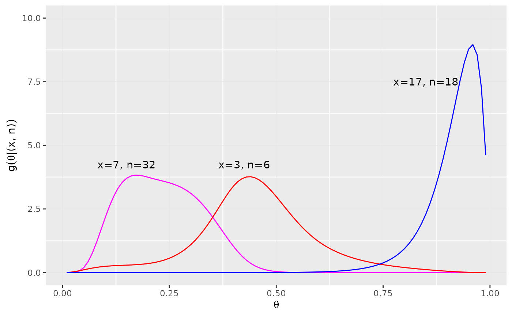

The empirical Bayes posterior estimate \\\theta^{EB}\\ for patients 34,
40, and 679 in the dataset for example is

``` r

cat(sprintf("Empirical Bayes Estimate: %f\n", 0.01 * sum(theta * g2)))
```

    ## Empirical Bayes Estimate: 0.453516

### Bootstrap Comparison

As a check on the estimates of standard error and bias provided by
`deconv`, we compare the results with what we obtain using a parametric
boostrap.

The boostrap is run as follows. For each of 1000 runs, 844 simulated
realizations \\\hat{\Theta}^\*\\ are sampled from density \\\hat{g}.\\
Each gave an \\X_i^\* \sim Binomial(n_i, \Theta_i^\*)\\ with \\n_i\\ the
\\i\\th sample in the original data set. Finally, \\\hat{\alpha}\\ was
computed using `deconv`.

``` r

set.seed(32776)
B <- 1000
gHat <- d$g
N <- nrow(surg)

genBootSample <- function() {
    thetaStar <- sample(tau, size = N, replace = TRUE, prob = gHat)
    sStar <- sapply(seq_len(N),
                    function(i)
                        rbinom(n = 1 , size = surg$n[i], prob = thetaStar[i]))
    data.frame(n = surg$n, s = sStar)
}

bootResults <- lapply(seq_len(B),
                      function(k) {
                          surgBoot <- genBootSample()
                          mat <- deconv(tau = tau, X = surgBoot, family = "Binomial",
                                        c0 = 1)$stats
                          mat[, c("g", "Bias.g")]
                      })

gBoot <- sapply(bootResults, function(x) x[, 1])
BiasBoot <- sapply(bootResults, function(x) x[, 2])

indices <- c(seq(1, 99, 11), 99)

table2 <- data.frame(theta = tau,
                     gTheta = round(gHat * 100, 3),
                     sdFormula = round(d$SE.g * 100, 3),
                     sdSimul = round(apply(gBoot, 1, sd) * 100, 3),
                     BiasFormula = round(d$Bias.g * 100, 3),
                     BiasSimul = round(apply(BiasBoot, 1, mean) * 100, 3))[ indices, ]
```

We print out some estimated quantities for comparison.

``` r

knitr::kable(table2, row.names = FALSE)
```

| theta | gTheta | sdFormula | sdSimul | BiasFormula | BiasSimul |
|------:|-------:|----------:|--------:|------------:|----------:|
|  0.01 | 12.326 |     0.870 |   0.911 |      -0.482 |    -0.543 |
|  0.12 |  1.033 |     0.127 |   0.135 |       0.051 |     0.058 |
|  0.23 |  0.369 |     0.054 |   0.061 |       0.023 |     0.027 |
|  0.34 |  0.757 |     0.093 |   0.091 |      -0.007 |    -0.008 |
|  0.45 |  1.113 |     0.118 |   0.113 |      -0.037 |    -0.036 |
|  0.56 |  0.543 |     0.102 |   0.097 |       0.015 |     0.016 |
|  0.67 |  0.262 |     0.046 |   0.049 |       0.021 |     0.024 |
|  0.78 |  0.213 |     0.053 |   0.050 |       0.018 |     0.018 |
|  0.89 |  0.308 |     0.052 |   0.046 |       0.014 |     0.013 |
|  0.99 |  0.575 |     0.158 |   0.157 |      -0.010 |    -0.014 |
